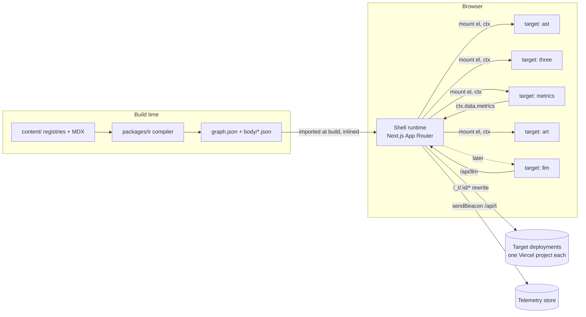

# The Traversal: Platform HLD

| | |
|---|---|
| Status | Draft v1, approved for Phase 0 |
| Date | 2026-10-28 |
| Owner | Rajat Kumar |
| Repo | github.com/RJonMshka/thetraversal |
| Related | `lld/01-content-ir.md`, `lld/02-target-contract.md`, `lld/03-shell-runtime.md`, `lld/04-build-deploy.md`, `lld/05-telemetry.md`, `MIGRATION.md` |

## 1. Intent

The Traversal today is one rendering of one tree: portfolio content shaped as an AST and walked in three depths (`lex`, `parse`, `eval`). This document describes how it becomes a platform where the same content is traversed in different domains: the AST, a 3D space, a live metrics dashboard, a generative art piece, and later an LLM conversation. Each domain is an independently built and deployed frontend, loaded on demand, switched without a page reload, and landing on the same focused entity.

The name, the landing experience, and the AST flavor stay. The AST stops being the data model and becomes the first of several targets.

## 2. The model

The architecture is a compiler, which is the site's own metaphor taken literally.

| Compiler stage | Platform component | Lives in |
|---|---|---|
| Source | Content registries + MDX | `content/` |
| Lexer + parser | Content compiler (validates, links, hashes) | `packages/ir` |
| IR | Typed entity graph (`graph.json`) + lazy bodies | build output, served by shell |
| Codegen targets | Targets: `ast`, `three`, `metrics`, `art`, `llm` | `targets/*` |
| Runtime | Shell: loads IR, loads targets, owns URL, focus, theme, chrome | `apps/shell` |
| ABI | Target contract (`mount / setFocus / unmount`) | `packages/contract` |

Each target is a different traversal of the same IR. The existing CLI flag language extends naturally: `--lex/--parse/--eval` choose depth within the AST target, `--target=three` chooses the backend.

Why "targets" and not "views": the word carries the compiler model, keeps the flag metaphor, and makes the README sentence write itself ("one IR, many codegen targets").

## 3. System context

## 4. Components

| Component | Responsibility | Does not |
|---|---|---|
| **Content** (`content/`) | Domain-typed registries (projects, roles, skills, essays, paper) and MDX prose. Publication flags. | Know about AST node types, colors, or any target. |
| **IR compiler** (`packages/ir`) | Zod schema, validation, edge resolution, MDX to HTML, content hashing, emits graph + bodies. Exposes typed `IRClient`. | Render anything. |
| **Contract** (`packages/contract`) | Types for `TargetManifest`, `TargetModule`, `TargetContext`, bus events. Tiny runtime: `createBus`, version range check. | Depend on React or Next. |
| **Tokens** (`packages/tokens`) | Theme definitions (moved from `src/lib/themes.ts`), `tokens.css`, `prose.css` for compiled MDX. | Ship JS that targets must import. |
| **Shell** (`apps/shell`) | Landing (`/`), node pages (`/node/[slug]`, SSR), target host (`/t/[target]`), registry, loader, transitions, focus, theme, context window, telemetry, server routes. | Contain target-specific rendering. |
| **Targets** (`targets/*`) | Render the IR in one domain. Report focus changes through `ctx.nav`. Clean up fully on unmount. | Fetch IR URLs directly, touch the DOM outside their root, write the URL. |
| **Target kit** (`packages/target-kit`) | Dev harness: mounts a target standalone with a fixture IR and a mock shell. | Ship to production. |

### Target lineup

| Target | Stack | What it proves | Phase |
|---|---|---|---|
| `ast` | React 19, D3 (layout only), Framer Motion | The existing site survives extraction intact | 3 (local), 4 (remote) |
| `three` | Vanilla three.js, no framework | Contract is framework-agnostic; WebGL lifecycle discipline | 5 |
| `metrics` | Preact or Svelte, uPlot | The platform observing itself; Datadog-style RUM as a live artifact | 6 |
| `art` | Canvas 2D or WebGL shaders | Expressive range; reduced-motion handling | 7 |
| `llm` | Any, server route to Claude API | IR as retrieval corpus; a target that drives other targets | 8 |

## 5. Runtime flows

**First visit to `/t/three?focus=reachble`**
1. Server renders the shell plus a text outline of the IR inside the target host (crawlable, works without JS).
2. Client hydrates. IR graph is already in the page payload; no fetch.
3. Loader resolves the `three` manifest, checks contract and IR ranges and capabilities (WebGL probe), loads the remote entry through the same-origin rewrite.
4. Target mounts into a shadow root, receives `focus = "reachble"`, signals ready. Outline is removed. Telemetry records the load breakdown.

**Switching `ast` to `three`**
1. User picks `--target=three`. Shell pushes `/t/three?focus=<current>`.
2. Remote was prefetched on idle or on hover of the switcher. `ast` stays visible during load.
3. `three` mounts hidden, signals ready, then a View Transition swaps them. `ast` unmounts (or is kept warm, see LLD-03 §6).
4. Focus is preserved because it lives in the URL and the shell, not in the target.

**Failure**
A load timeout, incompatible manifest, failed capability check, or a thrown error during mount keeps the user on the current target and shows a compiler-style diagnostic (`error[T0003]: target 'three' requires webgl2`). On a cold deep link with nothing to fall back to, the shell mounts `ast`, and if that fails, the text outline stays.

**Deep link to a node**
`/node/[slug]` remains server-rendered from the IR. It is the canonical, linkable, crawlable page for every entity regardless of which targets exist.

## 6. State ownership

| State | Owner | Persistence |
|---|---|---|
| IR graph, bodies | Shell (read-only to targets) | Build artifact, HTTP cache |
| Active target, focus | Shell, single writer | URL (`/t/[target]?focus=`) |
| Visited entities, context window | Shell | sessionStorage `tv.shell.*` |
| Theme, font | Shell | localStorage `tv.theme.cmd` (existing key) |
| Target-local state (AST mode, expanded nodes, camera) | Target, via `ctx.storage` | sessionStorage `tv.t.<id>.*` |
| Target URL params (AST `mode`) | Target declares, shell writes | URL, allowlisted per manifest |

Targets request changes; the shell decides and broadcasts. This keeps back/forward, deep links, and cross-target continuity correct without coordination between targets.

## 7. Quality attributes

| Attribute | Target |
|---|---|
| Shell initial JS | < 150 KB gzipped, excluding any target |
| IR graph | < 60 KB gzipped (bodies lazy) |
| Target switch, warm | p75 < 400 ms input to visible |
| Target switch, cold | p75 < 1500 ms on 4G |
| Per-target JS budget | Declared in manifest, enforced in CI |
| Lighthouse on `/` and `/node/*` | Keep current: ≥95 perf, 100 a11y, best practices, SEO |
| Accessibility | Every target declares `a11y: full | partial | decorative`. `partial` and `decorative` targets must render the shell's synced accessible entity list. `prefers-reduced-motion` honored by all. |
| Resilience | No target failure can blank the page. Shell owns error boundaries, timeouts, fallback chain. |
| Security | All target code served same-origin via rewrites, so CSP stays `script-src 'self'`. Targets get no secrets. LLM keys stay server-side. |
| Privacy | Telemetry carries no IP, no UA string, a daily-rotating session hash. Disclosed in the footer. |

## 8. Decisions

| # | Decision | Rejected alternatives and why |
|---|---|---|
| ADR-1 | Evolve the existing repo into a pnpm + Turborepo monorepo. | New repo: loses the history that shows the decomposition. Repo per target: independence comes from deploys, not repos; cross-repo contract changes become release choreography. |
| ADR-2 | Domain-typed IR is canonical. AST is a projection owned by the `ast` target. | Keep AST types as the model: every other target would inherit `FunctionDeclaration` as the word for "project", and the AST collapses distinctions (`ImportDeclaration` is both resume and education; `StringLiteral` is skills, roles, degrees, and contact channels). |
| ADR-3 | DOM-level contract: `mount(el, ctx)`. | React component contract: forces every target into React and couples React versions. |
| ADR-4 | Shell uses `@module-federation/runtime` (bundler-agnostic) to load remotes built with `@module-federation/vite`. Loader is behind an interface with a plain ESM `import()` strategy as fallback. | `@module-federation/nextjs-mf`: no App Router support and tied to webpack while Next 16 defaults to Turbopack. Vercel multi-zones: a zone change is a full navigation, which defeats seamless switching. |
| ADR-5 | Targets served same-origin through `/_t/:id/*` rewrites to each target's deployment. | Cross-origin remotes: CORS on every chunk, wider CSP, more failure modes. |
| ADR-6 | Each target mounts into a Shadow DOM root. Tokens cross the boundary as CSS custom properties. | Global CSS with conventions: one target's reset breaks another. iframes: kills focus continuity and transitions. |
| ADR-7 | Shell is the single writer of URL and focus. | Targets writing URL: races during transitions, broken back button. |
| ADR-8 | No shared framework singletons in v1; each target bundles its own framework. Revisit with an import map once two or more React targets exist. | Shared React from the shell: Next bundles its own React internally, so sharing it with remotes is fragile across Next upgrades. |
| ADR-9 | `/node/[slug]` stays SSR and target-independent. | Making targets responsible for SEO: most cannot provide it. |
| ADR-10 | Compiled MDX ships as sanitized HTML in IR bodies, styled by `prose.css`. | Shipping MDX source to targets: every target would need an MDX runtime. Verified safe: current MDX files contain no JSX components; `mdx-components.tsx` only restyles elements. |
| ADR-11 | MFKit becomes the loader and remote tooling once its runtime is stable; until then use MF runtime directly behind `TargetLoader`. | Block the platform on MFKit maturity. |

## 9. Roadmap

Phases are detailed in `MIGRATION.md`. Each phase ships to production on its own and leaves the site working.

| Phase | Outcome |
|---|---|
| 0 | Baseline: parity snapshots, budgets recorded, `CLAUDE.md` replaces stale `AGENTS.md` |
| 1 | Monorepo; current app moved to `apps/shell` unchanged |
| 2 | Content IR; `@/data` facade reimplemented over the IR via AST projection; golden test proves equality |
| 3 | Contract + target host in shell; AST runs as a local target through the contract only |
| 4 | AST extracted to `targets/ast`, federated, deployed independently |
| 5 | `three` target |
| 6 | Telemetry + `metrics` target |
| 7 | `art` target |
| 8 | `llm` target |

## 10. Open questions

1. Should the landing (`/`) offer target choice, or stay single-cursor and expose targets only from the tree chrome? Current invariant says nothing auto-unfolds, which argues for the latter.
2. Telemetry store: Supabase Postgres (percentiles in SQL) vs Upstash Redis (cheaper, harder aggregates). LLD-05 assumes Supabase.
3. Whether `docs/CONTENT-v2.md` (local, gitignored) remains the editorial source, or `content/` becomes the only source.
4. Target ids are permanent URL segments. Confirm `ast`, `three`, `metrics`, `art`, `llm` before Phase 3.
